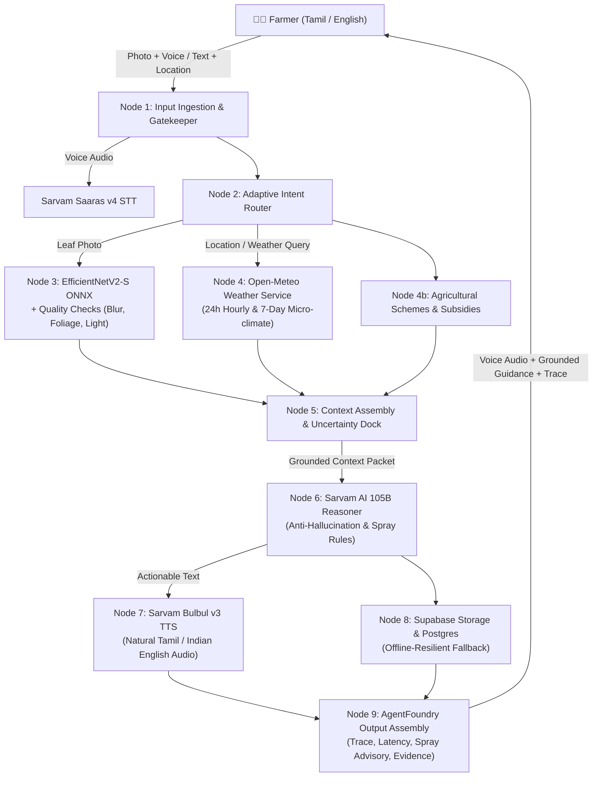

# 🌾 AgroNex Agent — Autonomous AI Copilot for Farmers

[](LICENSE)
[](https://python.org)
[](https://fastapi.tiangolo.com)
[](https://react.dev)
[](https://onnxruntime.ai)
[](https://sarvam.ai)
[](https://agentfoundry.me)

> **AgroNex Agent** is an autonomous, multimodal agricultural copilot built for Indian smallholder and commercial farmers. Designed for the **Bharat Agentic-AI / Code for a Billion Hackathon 2026** on the **AgentFoundry** platform, it coordinates computer-vision crop disease detection, live micro-climate weather risk feeds, and bilingual voice/chat reasoning (Tamil & English) into an evidence-grounded action loop.

---

## 🧭 Architecture Overview

AgroNex transforms passive machine learning into an active **governed agent loop**. Rather than returning raw probabilities or hallucinated advice, the **AgroNex Agent** synthesizes model observations with real-time weather constraints to generate safe, actionable farm management decisions.



---

## ⚡ AgentFoundry 10-Step Workflow

The agentic pipeline is formally specified in [`workflows/agronex_agent_workflow.yaml`](workflows/agronex_agent_workflow.yaml) and [`.agentfoundry/workflow.json`](.agentfoundry/workflow.json):

1. **Multimodal Ingestion**: Accepts farmer voice recordings, live camera snapshots, text prompts, and GPS coordinates.
2. **Audio Transcription**: Calls Sarvam Saaras v4 STT (`codemix` mode) for natural spoken Tamil and Indian English.
3. **Adaptive Tool Routing**: Dynamically decides whether computer vision, meteorological lookup, or knowledge retrieval is required.
4. **Computer Vision Inference**: EfficientNetV2-S ONNX model with EXIF correction, blur Laplacian variance filtering, overexposure clipping detection, and minimum foliage ratios.
5. **Real-time Meteorological Feed**: Open-Meteo live forecast (24-hour hourly temperatures, rainfall amounts, wind speeds, and 7-day outlook).
6. **Spray Window Risk Gate**: Automatically evaluates whether upcoming rain (>60% probability or >2mm) or high winds (>25 km/h) make pesticide/fertilizer spraying unsafe.
7. **Uncertainty Gatekeeper**: If model confidence is `<60%` or image quality fails, the agent flags the observation and instructs the farmer to seek extension officer confirmation.
8. **Bilingual Agricultural Reasoning**: Prompt-grounded Sarvam 105B LLM synthesizes evidence into clear, direct advice, emphasizing organic remedies and cultural sanitation first.
9. **Speech Synthesis**: Sarvam Bulbul v3 generates natural spoken voice audio in Tamil (`ta-IN`) or English (`en-IN`).
10. **Evidence & Cloud Persistence**: Saves the analysis and trace to Supabase (`crop_analyses`, `chat_history`), operating in graceful offline fallback if cloud credentials are not supplied.

---

## 🛠️ Repository Structure

```
├── .agentfoundry/              # Official AgentFoundry workflow metadata
│   └── workflow.json
├── workflows/                  # AgentFoundry YAML workflow specifications
│   └── agronex_agent_workflow.yaml
├── backend/                    # FastAPI backend & ML reasoning engine
│   ├── api/                    # REST routes
│   │   ├── agent.py            # /api/agent (Unified multimodal copilot endpoints)
│   │   ├── crops.py            # /api/crops (EfficientNetV2 disease detection)
│   │   ├── assistant.py        # /api/assistant (Sarvam AI voice & chat endpoints)
│   │   ├── weather.py          # /api/weather (Open-Meteo forecasts)
│   │   ├── google_auth.py      # /api/google-auth (Google OAuth token verifier)
│   │   ├── schemes.py          # /api/schemes (PM-KISAN subsidies)
│   │   └── profile.py          # /api/profile (Farmer profile)
│   ├── services/
│   │   ├── agent/              # Autonomous copilot workflow implementation
│   │   │   └── agronex_agent.py
│   │   ├── ai/                 # Core AI service engines
│   │   │   ├── disease_detector.py (ONNX runtime, quality gates, TTA)
│   │   │   └── ai_assistant.py     (Sarvam STT, LLM, TTS, prompt grounding)
│   │   └── weather_service.py  # Open-Meteo feed & alert risk calculations
│   ├── models/                 # Neural network weights & disease label mappings
│   │   ├── efficientnet_v2_s_best.onnx (~80 MB)
│   │   └── classes.json        (38 PlantVillage disease classes)
│   ├── tests/                  # Automated test suite
│   │   └── test_agent_workflow.py (6 integration test scenarios)
│   ├── test_model.py           # 12-scenario computer vision validation suite
│   ├── Dockerfile              # Backend container build
│   └── requirements.txt
├── frontend/                   # React 19 + Vite + Tailwind CSS v4 Single Page App
│   ├── src/
│   │   ├── pages/
│   │   │   ├── CropCheck.jsx   (Leaf scanning with camera & drag-drop)
│   │   │   ├── Result.jsx      (Diagnostic view + interactive AI Copilot follow-up)
│   │   │   ├── Assistant.jsx   (Full-screen voice & chat assistant)
│   │   │   ├── Weather.jsx     (24h hourly cards + 7-day forecast + spray alerts)
│   │   │   ├── Dashboard.jsx   (Farmer farm overview)
│   │   │   ├── Home.jsx        (Landing page)
│   │   │   └── Login.jsx       (Google OAuth & Farmer credentials)
│   │   ├── components/         # Layout, WeatherCard, WeatherAlerts
│   │   ├── features/googleAuth # Google OAuth client integration
│   │   └── i18n/               # en.json & ta.json bilingual translation dictionaries
│   ├── Dockerfile              # Frontend multi-stage Nginx container
│   └── package.json
├── docker-compose.yml          # One-command orchestration
├── render.yaml                 # Cloud deployment blueprint
├── supabase_schema.sql         # Supabase PostgreSQL schema, RLS & storage
├── start.bat                   # Windows one-click local server launcher
└── LICENSE                     # Apache-2.0 Open Source License
```

---

## 🚀 Quickstart Guide

### Option 1: One-Click Startup (Windows)

Simply double-click:
```bat
start.bat
```
This activates your Python environment, starts the FastAPI server on `http://localhost:8000`, and launches Vite on `http://localhost:5173`.

---

### Option 2: Manual Local Setup

#### 1. Backend Setup
```bash
cd backend
python -m venv venv
# Windows:
venv\Scripts\activate
# Linux / macOS:
source venv/bin/activate

pip install -r requirements.txt
cp .env.example .env
# Edit .env and insert your SARVAM_API_KEY

uvicorn main:app --host 0.0.0.0 --port 8000 --reload
```

#### 2. Frontend Setup
```bash
cd frontend
npm install
npm run dev
```
Open [http://localhost:5173](http://localhost:5173) in your browser.

---

### Option 3: Docker Compose
```bash
docker compose up --build
```

---

## 🔑 Environment Variables

| Variable | Scope | Description | Required? |
| :--- | :--- | :--- | :--- |
| `SARVAM_API_KEY` | Backend | Sarvam AI API subscription key for STT, LLM, and TTS | **Yes** (Voice & AI) |
| `SUPABASE_URL` | Backend | Supabase Project URL (`https://xyz.supabase.co`) | Optional (Graceful fallback) |
| `SUPABASE_PUBLISHABLE_KEY` | Backend | Supabase Anon / Service Role key | Optional (Graceful fallback) |
| `GOOGLE_CLIENT_ID` | Backend | Google OAuth 2.0 Client ID for token verification | Optional |
| `FRONTEND_URL` | Backend | Frontend URL for CORS (default: `http://localhost:5173`) | Optional |
| `ALLOW_ALL_ORIGINS` | Backend | Enable wildcard CORS (`true`/`false`) | Optional |
| `VITE_API_URL` | Frontend | Target backend URL (default: `http://localhost:8000`) | **Yes** |
| `VITE_GOOGLE_CLIENT_ID`| Frontend | Google OAuth Client ID for frontend button | Optional |

---

## 🧪 Automated Testing

### 1. AgentFoundry Workflow Test Suite
Validates multimodal routing, weather integration, Tamil generation, and Supabase offline resilience:
```bash
cd backend
python -m unittest tests/test_agent_workflow.py
```
*Expected: 6/6 tests passing (`OK`).*

### 2. Computer Vision Preprocessing Suite
Validates 12 edge-case scenarios including EXIF transpositions, blur Laplacian variance, overexposure clipping, low light, and Test-Time Augmentation (TTA):
```bash
cd backend
python test_model.py
```
*Expected: 12/12 preprocessing scenarios passing (`OK`).*

### 3. Frontend Production Build
Validates Vite bundler, React 19 components, Tailwind CSS v4, and i18n dictionaries:
```bash
cd frontend
npm run build
```
*Expected: Clean build into `frontend/dist`.*

---

## 📡 REST API Reference

| Method | Endpoint | Description |
| :--- | :--- | :--- |
| `POST` | `/api/agent/run` | Multimodal Copilot: accepts `query`, `image`, `audio`, `latitude`, `longitude`, `language`. Returns full grounded recommendation, spray advisory, audio base64, and execution trace. |
| `POST` | `/api/agent/chat` | Fast JSON copilot chat with contextual grounding and weather evaluation. |
| `GET` | `/api/agent/workflow`| Returns AgentFoundry workflow manifest and active node status. |
| `POST` | `/api/crops/analyze` | Direct EfficientNetV2 inference on uploaded plant leaf. |
| `GET` | `/api/crops/history` | Retrieves historical analysis records from Supabase. |
| `GET` | `/api/weather/forecast`| Returns 24h hourly and 7-day agricultural forecasts with spray alerts. |
| `POST` | `/api/assistant/chat` | Conversational text chat with agricultural guidance. |
| `POST` | `/api/assistant/voice`| Spoken voice chat: STT $\rightarrow$ Grounded Reasoning $\rightarrow$ TTS. |
| `POST` | `/api/google-auth/login`| Verifies Google OAuth credential tokens securely. |
| `GET` | `/health` | Service health status check. |

---

## 🛡️ Responsible AI, Safety & Grounding Principles

1. **Prediction $\neq$ Diagnosis**: AI visual models detect probabilistic visual patterns. If model confidence is `<60%`, AgroNex marks the status as **Uncertain** and explicitly advises the farmer to consult a local **Krishi Vigyan Kendra (KVK)** or agricultural officer before committing financial resources.
2. **Weather-Grounded Spray Window**: AgroNex checks live rainfall and wind velocity before confirming spray advice. If rain is forecast ($>60\%$ or $>2\text{ mm}$), the agent strictly advises **against** foliar chemical application.
3. **No Fabricated Dosages**: The agent prioritizes organic and cultural controls (sanitation, spacing, neem oil, bio-fungicides) and refuses to fabricate unverified proprietary chemical dosages.
4. **Bilingual Inclusion**: First-class support for Tamil (`ta-IN`) and English ensures smallholder farmers across South India can query the assistant naturally using voice or text.

---

## 🏆 Hackathon Submission Details

- **Event**: Code for a Billion – Bharat Agentic-AI Hackathon 2026
- **Organizer**: Code for India (CFI) in partnership with NASSCOM / SSC FutureSkills Prime
- **Platform**: AgentFoundry (`agentfoundry.me`)
- **Workflow ID**: `agronex-farming-copilot`
- **License**: Apache-2.0 Open Source

---

## 📄 License

Licensed under the **Apache License, Version 2.0**. See the [LICENSE](LICENSE) file for terms and conditions.
